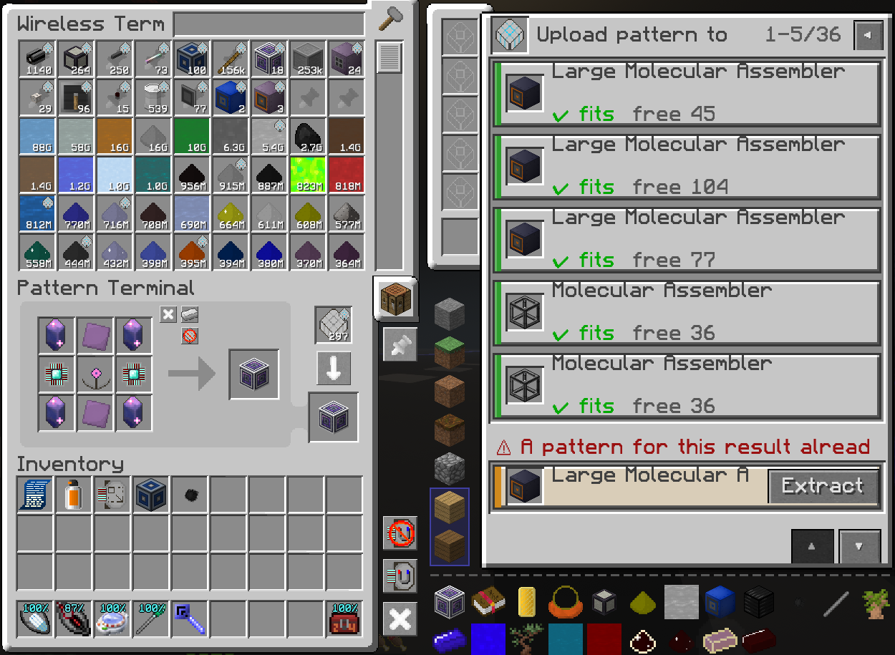
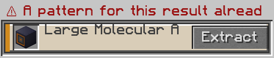

# Pattern Router

Side panel for the AE2 pattern terminal in GT: New Horizons. After you encode a processing pattern, it lists the ME
interfaces and CRIBs whose GregTech machine can run that recipe. One click puts the pattern there.


https://github.com/user-attachments/assets/6eed40cf-077b-4422-a57c-003cbaba9132



## Features
- **Machine match by recipe map**, not by name. Renamed interfaces still work.
- **Mold / circuit / lens check** with the real GT recipe lookup: pattern inputs plus what the machine holds (CRIB
  manual and circuit slots, the machine next to an ME interface, input buses, fluid hatches such as the GT++
  Solidifier Hatch, the controller's circuit slot). The row shows what the machine is set up with, e.g. `{[5]}`.
  - Any lens (mold, …) that gives the same result *fits*; the pattern must be a whole multiple of the recipe and the
    recipe must use every pattern input (an EBF set to `[1]` doesn't take a "dust + 100 L gas" pattern made for `[11]`).
  - Several circuits in one bus are fine (an LCR with `[1] [12] [14] [15]`). A machine is marked *doesn't fit* only if
    what it holds would also start a recipe with another output; machines set up exactly for the recipe come first.
  - For fluid patterns, providers that can't push fluids are marked *doesn't take fluids* and hidden as soon as some
    machine fits; if none fits they stay listed with that mark.
  - Interface on a fluid hatch of a multiblock with input separation: every input bus is tried, as GT does.
  - Works without NEI too.
- **Your choice is remembered** (per player, in the world save): next time the same kind of pattern lists that
  interface first, even if the machine behind it is out of sight (chest, conduit). Choices made on a P2P interface
  output before 1.3.9 are not recognised any more (the panel now lists the P2P input instead): pick it once again.
- **NEI tab decides the machine**: a recipe moved from the "Cable Coating" tab goes to the L.A.T.E.X., not to
  assemblers that have a similar recipe.
- **Machine modes**: a multiblock with modes (Precise Assembler, Circuit Assembly Line, distillation towers, GT++
  wash plant, packager, press, dehydrator, electromagnetic separator...) fits only recipes of the mode it is set to.
  A recipe of another mode is shown as "other mode" (and hidden when some machine fits).
- **Skipped vacuum freezer step**: a "dust -> ingot" pattern for a metal that the EBF makes as a hot ingot goes to
  the EBF, for setups where an import bus (e.g. with an ore dictionary card) carries the hot ingot to the freezer.
  Used only when no machine makes the ingot from the pattern inputs directly.
- **Renamed interfaces** match the NEI tab name ("≈ by name") when the machine behind them can't be seen. Only names
  you gave count (an unnamed AE2 interface shows its neighbour's name, e.g. "Molecular Assembler"). Words shared by
  many machines ("furnace", "electric") don't count: "Electric Blast Furnace" does not match "Arc Furnace".
- **Can the machine actually run it?** A machine that takes the recipe but can't run it is marked, with the reason in
  the tooltip. Multiblocks are asked through their own GT processing logic: power from their energy, multi-amp,
  laser or wireless hatches (with their EU discount), then their own recipe check (coil heat with its per-voltage
  bonus, glass or casing tier where the machine limits recipes by it, ...). Single blocks: voltage, cleanroom
  (formed and clean), low gravity, multiblock-only compression recipes. Short marks in the row: *can't power it*,
  *too cold*, *no cleanroom*, *not in space*, *won't start*.
- **Assembly lines** fit only when their data sticks (controller slot, data access hatches, optical or wireless data
  input) hold the recipe; otherwise *not researched*. Behind a P2P interface every line must have it.
- **Why not?** Hover a red row: the tooltip says why (other mode and which one, no research, power needed vs given,
  heat needed vs the machine's, GT's own message in your language).
- **Duplicates**: putting a pattern whose output is already in the network asks *Remove the duplicates?* Yes moves
  every copy into your inventory once the new one is in; No keeps them (parallel crafting); Esc cancels.
- **P2P interfaces**: the input is listed, the machines next to its outputs are checked; unlinked P2Ps are hidden.
- **Transvector Interfaces** (Thaumic Tinkerer) and **SFM relays**: the machine behind them is found.
- **Pattern Repeaters**: machines in networks linked by AE2 Pattern Repeaters are found too.
- **Subnets**: an interface that pushes into another ME network finds the GT machines that subnet feeds (its ME input
  buses/hatches, export or storage buses on machine buses, interfaces next to machines). Only a neighbour that takes
  what the interface pushes (an ME interface, ME chest, ...) leads into a subnet, and networks of over 4096 nodes are
  not treated as subnets.
- **Full interface?** A Pattern Capacity Card is installed from your inventory, then from the network.
- **Crafting patterns** go to molecular assemblers: interfaces next to an AE2 Molecular Assembler and the GT Large
  Molecular Assembler.
- **Unformed multiblocks** are reported ("check the structure") instead of silently missing.
- **Conflicts.** Shows patterns elsewhere in the network that already produce the same output, with an *Extract*
  button that moves the old pattern to your inventory.

  

- **Highlight**: Shift+click a row (or click a conflict) to highlight the interface in the world.
- **Respects AE2 security** (build permission).
- English, Russian, Chinese.
- **NEI makes room** for the panel (`INEIGuiAdapter`).
- **Light touch on AE2's GUI**: the panel is built from Forge GUI events; two small client mixins only take the
  mouse wheel over the panel and the keys while its search field or question has focus.

## Requirements
Client **and** server. Needs AE2 (GTNH fork), GT5-Unofficial and NotEnoughItems — all already in GTNH. Built against
GTNH 2.9.0-RC-2; runs on 2.9.0. Tested in single player, on the official 2.9.0-RC-2 dedicated server pack and on
a large live server. 1.3.x and 1.4 talk to each other (1.4 adds its data at the end of the messages, older versions
skip it); most machine checks run on the server, so update the server to get them. A 1.4 client on an older server
says so in the tooltip instead of guessing a reason.

Install: put `patternrouter-<version>.jar` (not `-dev` / `-sources`) into `mods`. If only one side has the mod, players
can still connect; the panel finds nothing and after 10 s says that the server does not answer.

## Performance
A lookup runs only when a pattern is encoded or the terminal is opened, on the server thread, with at most ~25 ms of
lookups per tick (the rest waits for the next tick). Otherwise the mod only checks its empty queue once per tick.
Each player has at most one list request waiting (a newer one replaces it) and a few uploads/extractions.

`/patternrouter bench [runs]` (op) replays your last panel lookup (same pattern, network, NEI category) once per
tick, skips 3 warm-up runs and prints the timings. Results on a live UIV-stage server, 669 interfaces/CRIBs, worst
case (no NEI category: the GT lookup goes over every machine), 50 runs each:

| first | min | median | p95 | max | mean |
|---|---|---|---|---|---|
| 19.7 ms | 12.8 | 14.4 | 18.3 | 19.4 | 14.9 |
| 13.2 ms | 12.4 | 13.2 | 16.1 | 18.9 | 13.5 |
| 14.5 ms | 12.0 | 12.6 | 14.6 | 15.9 | 12.8 |

Every real request is timed in `logs/fml-server-latest.log` (debug); over 200 ms it is a console warning, over 2 s
the server thread stack is logged.

## Panel
- Drag the panel by its title to put it anywhere; the position is kept relative to the terminal.
- The arrow in the title snaps it back to the automatic place on the left or right.
- The square in the title hides interfaces with no free slot (and no room for a capacity card).
- The search field filters the list by name.
- Scroll with the wheel or the scroll bar; the list always stops on whole rows.
- Drag the bottom-right corner to show more or fewer rows (2-20).
- The pattern button under AE2's button column left of the terminal folds the panel away (no lookups while folded).
- NEI hides its items under the panel; automatic placement stays below NEI's page bar.

Saved in `config/patternrouter.cfg` (`panelSide`, `panelCustom`, `panelX`, `panelY`, `hideFull`, `panelRows`,
`panelHidden`).

## Building
```
gradlew build
```
Java 21 (Jabel, targets Java 8).

## Credits
Idea from GregTech Odyssey (gtocore) and AE2 Auto Pattern Upload (GaLicn). No code was copied.
