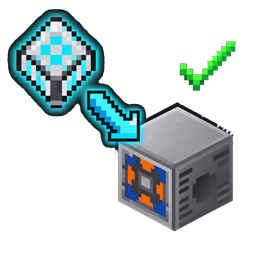

# Pattern Router

Side panel for the AE2 pattern terminal in GT: New Horizons. After you encode a processing pattern, it lists the ME
interfaces and CRIBs whose GregTech machine can run that recipe. One click puts the pattern there.



## Features
- **Machine match by recipe map**, not by name. Renamed interfaces still work.
- **Mold / circuit / lens check** with the real GT recipe lookup: pattern inputs plus what the machine holds (CRIB
  manual and circuit slots, the machine next to an ME interface, input buses, fluid hatches such as the GT++
  Solidifier Hatch, the controller's circuit slot). The row shows what the machine is set up with, e.g. `{[5]}`.
  - Any lens (mold, …) that gives the same result *fits*; the pattern must be a whole multiple of the recipe.
  - A machine holding a circuit/mold/lens the recipe doesn't use is hidden when another machine fits, otherwise marked
    *doesn't fit*.
  - Fluid patterns are not offered to providers that can't push fluids.
  - Interface on a fluid hatch of a multiblock with input separation: every input bus is tried, as GT does.
  - Works without NEI too.
- **Your choice is remembered** (per player, in the world save): next time the same kind of pattern lists that
  interface first, even if the machine behind it is out of sight (chest, conduit).
- **Renamed interfaces** match the NEI tab name ("≈ by name") when the machine behind them can't be seen.
- **Pattern Repeaters**: machines in networks linked by AE2 Pattern Repeaters are found too.
- **Full interface?** A Pattern Capacity Card is installed from your inventory, then from the network.
- **Crafting patterns** go to molecular assemblers: interfaces next to an AE2 Molecular Assembler and the GT Large
  Molecular Assembler.
- **Unformed multiblocks** are reported ("check the structure") instead of silently missing.
- **Conflicts.** Shows patterns elsewhere in the network that already produce the same output, with an *Extract*
  button that moves the old pattern to your inventory.
- **Highlight**: Shift+click a row (or click a conflict) to highlight the interface in the world.
- **Respects AE2 security** (build permission).
- English, Russian, Chinese.
- **NEI makes room** for the panel (`INEIGuiAdapter`).
- **AE2 GUIs are not patched.** The panel uses Forge GUI events only.

## Requirements
Client **and** server. Needs AE2 (GTNH fork), GT5-Unofficial and NotEnoughItems — all already in GTNH. Built against
GTNH 2.9.0-RC-2; also loads on RC-1. Tested in single player, on the official 2.9.0-RC-2 dedicated server pack and on
a large live server. Client and server need the same version (the network channel changes between versions).

Install: put `patternrouter-<version>.jar` (not `-dev` / `-sources`) into `mods`. If only one side has the mod, players
can still connect; the panel just finds nothing.

## Panel position
- Drag the panel by its title to put it anywhere; the position is kept relative to the terminal.
- The arrow in the title snaps it back to the automatic place on the left or right.
- NEI hides its items under the panel; automatic placement stays below NEI's page bar.

Saved in `config/patternrouter.cfg` (`panelSide`, `panelCustom`, `panelX`, `panelY`).

## Building
```
gradlew build
```
Java 21 (Jabel, targets Java 8).

## Credits
Idea from GregTech Odyssey (gtocore) and AE2 Auto Pattern Upload (GaLicn). No code was copied.
